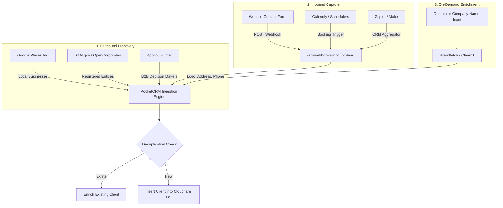

# PocketCRM — Customer Auto-Feed, Discovery & Enrichment Plan

This document outlines architectural patterns, public registries, commercial data APIs, and inbound webhook workflows for automatically discovering, enriching, and ingesting business clients into **PocketCRM**.

---

## 1. Core Acquisition Vectors



---

## 2. Public & Government Data Sources (Free / Near-Zero Cost)

### A. SAM.gov Entity Management API (US General Services Administration)
* **Coverage**: Millions of active US commercial businesses, federal contractors, vendors, and service providers.
* **Data Fields**:
  * Legal Business Name & DBA (Doing Business As)
  * Unique Entity Identifier (UEI) / CAGE Code / DUNS
  * Physical Street Address, City, State, ZIP+4, Country
  * NAICS / SIC Industry Classification Codes
  * Point of Contact (POC) names, official email, and phone
* **Cost**: **100% Free** (Requires registering for a free SAM.gov developer API key).
* **Fit for PocketCRM**: Ideal for B2B consulting, trade services, IT providers, and federal/state contractors.

### B. OpenCorporates REST API
* **Coverage**: The largest open database of legal company entities worldwide (200M+ companies across US states, Canada, UK, EU, etc.).
* **Data Fields**:
  * Legal registered entity name and entity number
  * Jurisdiction / State of incorporation
  * Current status (`Active`, `Dissolved`, `Good Standing`)
  * Registered agent name and official headquarters address
* **Cost**: Free community tier (500 requests/month) and scalable commercial tiers.
* **Fit for PocketCRM**: Instantly verifies that a prospective client is a valid, legally registered business entity.

### C. ProPublica Nonprofit Explorer API
* **Coverage**: Complete IRS 990 database of all 501(c)(3) nonprofits, charities, healthcare foundations, and educational institutions.
* **Data Fields**: Organization name, EIN, address, annual revenue, executive directors, and tax filings.
* **Cost**: **100% Free** public REST API.
* **Fit for PocketCRM**: Perfect if targeting nonprofit organizations, schools, or community foundations.

### D. SEC EDGAR API
* **Coverage**: All publicly traded US corporations and major investment entities.
* **Data Fields**: Legal name, CIK, business address, IRS number, SIC industry code, corporate filings.
* **Cost**: **100% Free** public REST API (requires a custom `User-Agent` header).
* **Fit for PocketCRM**: Sourcing corporate headquarters info for larger enterprise accounts.

---

## 3. Local Business Discovery APIs (Trades, SMBs & Local Services)

### Google Places API (New) / Google Maps Platform
* **Capabilities**: Query by keyword and location (e.g., *"Plumbing in Dallas, TX"*, *"Law Firms in Denver"*, *"Medical Clinics in Atlanta"*).
* **Data Fields**:
  * Business Name
  * Verified Physical Address
  * Phone Number (international & national format)
  * Website URL
  * Operating Hours & Google Rating
* **PocketCRM Automation**:
  1. User enters industry + location into a "Discover Businesses" modal.
  2. Worker queries Google Places API.
  3. Displays a preview grid with one-click **"Add to Clients"**.
  4. PocketCRM queries the business website URL in the background to scrape or verify primary contact emails (`info@`, `contact@`, `billing@`).
* **Cost**: Google Cloud provides a **$200 monthly recurring credit**, yielding ~6,000–10,000 free place searches every month.

---

## 4. Commercial B2B & Contact Enrichment APIs

When direct decision-maker emails (Founders, Owners, CFOs, Operations Managers) are required:

| Provider | Core Strength | Extracted Attributes | Pricing Tier |
| :--- | :--- | :--- | :--- |
| **Apollo.io API** | 275M+ verified B2B profiles. Filter by company size, revenue, location, and seniority. | First/Last Name, direct email (verified), mobile/office phone, job title, LinkedIn profile, company headquarters. | Free tier (up to 50 credits/mo), affordable startup API tier. |
| **Hunter.io API** | Domain search & email pattern discovery. | Given a domain (`example.com`), returns all discovered corporate email addresses, confidence scores, and executive names. | Free tier (25 searches/mo), paid tiers for volume. |
| **Brandfetch API** | Instant company branding and profile auto-fill. | Given a company name or domain, returns official logo (SVG/PNG), primary brand colors, full address, and industry. | Generous free tier (up to 500 requests/mo). |

---

## 5. Inbound Lead Webhook (Automated Capture Pipeline)

To capture leads generated from existing marketing websites, scheduling apps, or landing pages:

### Endpoint Architecture
* **Path**: `POST /api/webhooks/inbound-lead`
* **Authentication**: Pre-shared bearer token or signature header:
  ```http
  Authorization: Bearer <CONFIGURED_WEBHOOK_SECRET>
  Content-Type: application/json
  ```
* **Payload Structure**:
  ```json
  {
    "name": "Jane Doe",
    "company": "Summit Logistics LLC",
    "email": "jane@summitlogistics.com",
    "phone": "(555) 234-5678",
    "address": "1200 Industrial Parkway",
    "city": "Columbus",
    "state": "OH",
    "postalCode": "43215",
    "source": "Website Contact Form",
    "notes": "Interested in annual managed IT services and network audit."
  }
  ```

### Processing Logic
1. **Validation**: Enforce schema via Zod (`name`, `email` or `phone` required).
2. **Deduplication**: Query D1 for existing client by email or company name:
   - If found: Append note with timestamp of new submission.
   - If new: Insert record into `clients` with tag/notes `[Inbound Lead]`.
3. **Optional Automation**:
   - Auto-create a draft Estimate / Quote.
   - Dispatch an instant internal email notification to the sales team using Cloudflare Workers `env.EMAIL`.

---

## 6. Implementation Roadmap

1. **Phase 1: Inbound Webhook Support**
   - Implement `POST /api/webhooks/inbound-lead` in `src/server/index.ts`.
   - Add Webhook Secret key management inside Admin Settings.
2. **Phase 2: One-Click Domain Enrichment**
   - Add an "Auto-Fill from Domain" button on the Client creation modal.
   - Fetches logo, address, and phone using Brandfetch / OpenCorporates.
3. **Phase 3: Prospector Discovery Modal**
   - Interactive search interface inside the Clients view.
   - Integrated with Google Places / SAM.gov for batch prospecting with duplicate detection.
