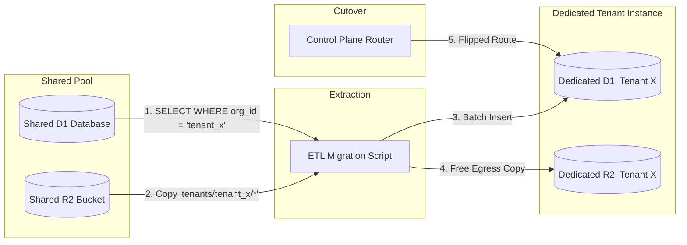

# PocketCRM Multi-Tenancy Architecture & Evolution Strategy

This document outlines the architectural blueprints, performance characteristics, and step-by-step separation strategy for transforming PocketCRM into a multi-tenant platform on Cloudflare Workers, Cloudflare D1, and Cloudflare R2.

---

## 1. Executive Summary & Strategy

* **Recommended Starting Point**: **Option 1 (Shared D1 Database with Row-Level Scoping via Better Auth)**.
* **Separation Capability**: By tagging every table and R2 asset with `organization_id` from day one, individual tenants can be migrated to dedicated, isolated D1 databases and R2 buckets later with zero code rewrites and zero downtime.
* **The "Gradual Hybrid" Advantage**: Standard clients stay on the fast, zero-maintenance shared pool, while high-value or compliance-sensitive clients can be spun off into dedicated databases.

---

## 2. Architectural Models

### Option 1: Shared Database with Row-Level Scoping (Fastest & Leanest)
* **Mechanism**: A single Cloudflare D1 database. All business tables (`clients`, `documents`, `catalog_items`, `document_templates`, `email_logs`, `audit_logs`) include an `organization_id` foreign key.
* **Auth**: Uses Better Auth's native `organization` plugin (`better-auth/plugins`), which provides organizations, members, invitations, and active organization switching.
* **Access Control**: Every query is scoped by the session's active organization ID:
  ```ts
  db.select().from(documents).where(and(eq(documents.id, id), eq(documents.organizationId, orgId)));
  ```

### Option 2: Database-per-Tenant (Physical Isolation)
* **Mechanism**: Each customer/tenant receives their own dedicated Cloudflare D1 database instance (e.g. `d1-tenant-acme`) and optionally a dedicated R2 bucket.
* **Auth & Routing**: A lightweight Control Plane database maps `organization_id -> d1_database_uuid`. The Worker edge middleware dynamically connects to that tenant's D1 binding.
* **Use Case**: Enterprise contracts, strict HIPAA/GDPR isolation, or tenants with massive query volume.

### Option 3: Hybrid Subdomain / Custom Domain (Cloudflare for SaaS)
* **Mechanism**: Option 1's shared database combined with vanity subdomains (`acme.pocketcrm.com`) or full custom domains (`billing.builtnetworks.com`).
* **Edge Resolution**: Worker inspects `c.req.header('host')` to resolve tenant identity before checking credentials.

---

## 3. Option 1 Performance Profile (Cloudflare Edge & SQLite)

From an architectural standpoint, Option 1 delivers near-native single-tenant performance because Cloudflare D1 is built on SQLite:

1. **Sub-Millisecond Read Latency**:
   - SQLite queries indexed with composite B-Trees (`INDEX (organization_id, status, issue_date)`) execute logarithmic ($O(\log N)$) seeks.
   - Searching 100,000 rows across 50 tenants takes virtually the exact same CPU time (**$0.15\text{ ms} - 0.40\text{ ms}$**) as searching a 500-row single-tenant table.
2. **Zero Extra Network Round-Trips**:
   - Better Auth bundles the `activeOrganizationId` into the validated session token in memory.
   - The Worker immediately knows the tenant boundary without querying a routing database first.
3. **WAL Concurrency**:
   - SQLite operates in Write-Ahead Logging (WAL) mode (unlimited concurrent readers, serialized fast writes).
   - Because CRM workloads are 90% read and writes execute in $< 1\text{ ms}$, D1 can comfortably process hundreds of transactions per second before queue contention.
4. **Storage Ceilings (10 GB Cap)**:
   - An average invoice + 5 line items occupies $\approx 1.5\text{ KB}$ in SQLite.
   - 100 tenants generating 500 invoices per year consume only $\approx 75\text{ MB/year}$.
   - The entire working index set fits directly inside SQLite's in-memory page cache, ensuring near-100% RAM hit rates.
5. **R2 Media Offloading**:
   - PDFs, receipts, and logos live in R2, namespaced by `tenants/{organization_id}/...`.
   - Media delivery is infinitely scalable and completely independent of D1 compute limits.

---

## 4. Migration Plan: Moving a Tenant from Shared Pool to Dedicated D1 & R2

When a tenant grows large or requests physical isolation, follow this 6-step zero-downtime migration process:



### Step 1: Establish the Control Plane Routing Map
Introduce a tenant routing table in Cloudflare KV or a central D1 control table:
```ts
interface TenantRoute {
  organizationId: string;
  databaseId: string;    // 'shared-d1' OR dedicated D1 UUID
  bucketName: string;    // 'shared-storage' OR dedicated bucket
  status: 'active' | 'migrating' | 'suspended';
}
```
All tenants default to `databaseId: 'shared-d1'`.

### Step 2: Automated Cloudflare Provisioning
Run a script using Wrangler or Cloudflare's REST API:
```bash
# 1. Create isolated D1 database
npx wrangler d1 create pocketcrm-tenant-acme

# 2. Run schema migrations
npx wrangler d1 migrations apply pocketcrm-tenant-acme --remote

# 3. (Optional) Create dedicated R2 bucket
npx wrangler r2 bucket create pocketcrm-storage-acme
```

### Step 3: Data Extraction & Hydration (Atomic Copy)
Extract the tenant's scoped records from the shared pool:
```sql
SELECT * FROM clients WHERE organization_id = 'tenant_x';
SELECT * FROM documents WHERE organization_id = 'tenant_x';
SELECT * FROM document_items WHERE document_id IN (SELECT id FROM documents WHERE organization_id = 'tenant_x');
SELECT * FROM catalog_items WHERE organization_id = 'tenant_x';
SELECT * FROM document_templates WHERE organization_id = 'tenant_x';
SELECT * FROM email_logs WHERE organization_id = 'tenant_x';
SELECT * FROM audit_logs WHERE organization_id = 'tenant_x';
```
Insert these records in batches into the dedicated database.

### Step 4: R2 File Replication ($0 Bandwidth Fee)
1. List all objects matching prefix `tenants/tenant_x/` in the shared R2 bucket.
2. Stream them into the dedicated bucket (`env.TENANT_R2.put(key, obj.body)`).
3. **Cost**: Intra-Cloudflare transfers between Workers and R2 have **$0 egress fees**, so moving gigabytes of PDFs is free.

### Step 5: Atomic Cutover (Zero Downtime)
1. Set `status: 'migrating'` in the routing map for Tenant X (read-only for 15 seconds).
2. Run a delta sync for any rows modified in the past 2 minutes.
3. Update routing map:
   ```json
   {
     "organizationId": "tenant_x",
     "databaseId": "d1-uuid-for-acme",
     "bucketName": "pocketcrm-storage-acme",
     "status": "active"
   }
   ```
4. From this millisecond forward, all Tenant X requests hit their isolated database.

### Step 6: Post-Cutover Cleanup
Once verified, purge the migrated records from the shared pool:
```sql
DELETE FROM documents WHERE organization_id = 'tenant_x';
DELETE FROM clients WHERE organization_id = 'tenant_x';
-- Run SQLite VACUUM to reclaim space
```

---

## 5. Schema Blueprint for Option 1 Implementation

When ready to implement Option 1, the following modifications will be made:

### Drizzle Model Changes (`src/db/schema.ts`)
```ts
// 1. Add Organization Table (via Better Auth plugin)
export const organizations = sqliteTable('organizations', {
  id: text('id').primaryKey(),
  name: text('name').notNull(),
  slug: text('slug').notNull().unique(),
  logo: text('logo'),
  createdAt: integer('created_at', { mode: 'timestamp_ms' }).notNull(),
});

// 2. Add organizationId to Business Tables with Composite Indexes
export const clients = sqliteTable('clients', {
  // ... existing fields ...
  organizationId: text('organization_id').notNull().references(() => organizations.id, { onDelete: 'cascade' }),
}, (table) => [
  index('clients_org_company_idx').on(table.organizationId, table.companyName),
  index('clients_org_code_idx').on(table.organizationId, table.code),
]);

export const documents = sqliteTable('documents', {
  // ... existing fields ...
  organizationId: text('organization_id').notNull().references(() => organizations.id, { onDelete: 'cascade' }),
}, (table) => [
  index('documents_org_status_idx').on(table.organizationId, table.type, table.status),
  index('documents_org_issue_idx').on(table.organizationId, table.issueDate),
]);
```

---

## 6. Summary Comparison

| Metric | Option 1 (Shared D1) | Option 2 (Dedicated D1 per Tenant) |
| :--- | :--- | :--- |
| **Setup Cost** | Low (days) | High (weeks) |
| **Monthly Infrastructure** | Included in standard Cloudflare plan | Scales with D1 database count |
| **Query Latency** | $< 0.5\text{ ms}$ (indexed B-Tree) | $< 0.5\text{ ms}$ (indexed B-Tree) |
| **Data Separation** | Logical (`organization_id`) | Physical (isolated SQLite files) |
| **Migrations** | 1 migration runs for everyone | Automated fleet migration script |
| **Compliance Export** | Filtered JSON export | Direct SQLite database file download |
